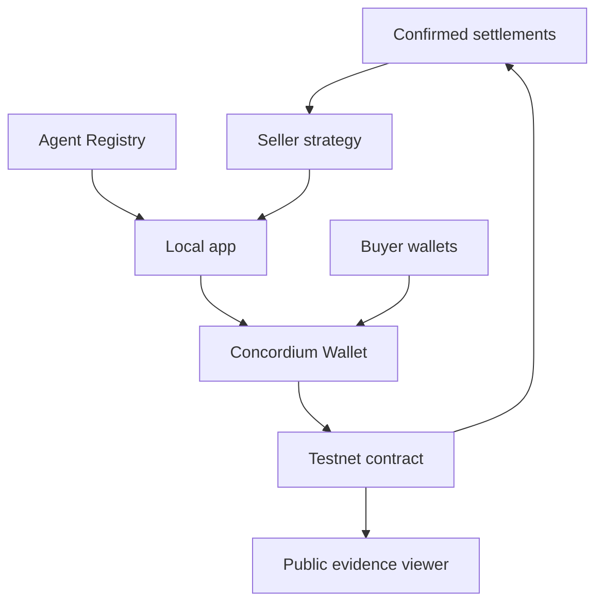
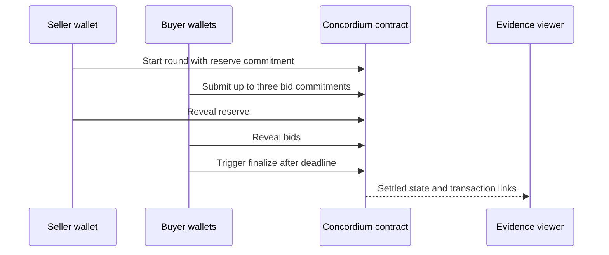

# SurplusBid

**When Capacity Expires, Let Agents Bid for It**

SurplusBid uses repeatable sealed-bid auctions on Concordium to allocate short-lived AI API capacity, share transaction surplus under public rules, settle testnet CCD, and publish price signals from confirmed settlements. The current prototype offers two one-unit allocations per contract instance; each instance runs one round. [Capacity and round constants](contracts/sealed-auction/src/lib.rs#L4) · [Example service specification](public/service-spec.json#L2) · [Price-signal filter](app/app.mjs#L1555)

**Quick links:** [Live evidence tour](https://surplus-bid.netlify.app/run/) · [Main Testnet contract `<13041,0>`](https://ccdexplorer.io/testnet/contract/13041/0) · [Final settlement](https://ccdexplorer.io/testnet/transaction/f576cb1e684155214c43b1ce71ad2ff2ea9c9a6b6fa550bcb36c5508a80c2293) · [Published evidence JSON](https://surplus-bid.netlify.app/evidence/judge-journey.json) · [中文说明](README.zh-CN.md). **Demo video:** pending.

## Problem

SurplusBid explores a market for short-lived AI API burst capacity: a seller offers standardized units for a time window, while buyers may value that window differently. This is the prototype's target scenario, expressed in its two-unit service specification; it is not evidence of demand from a live API provider. [Service specification](public/service-spec.json#L2) · [Current delivery boundary](public/service-spec.json#L5)

The prototype asks how to allocate two units when up to three buyers submit different one-unit bids. It accepts hidden commitments first, then discloses bids in a separate reveal period. [Contract limits](contracts/sealed-auction/src/lib.rs#L4) · [Commit/reveal entrypoints](contracts/sealed-auction/src/lib.rs#L300) · [Primary Testnet trace](public/evidence/judge-journey.json#L55)

## Solution

The Concordium contract fixes the capacity rule, accepts commitments and reveals, ranks eligible bids, and settles up to two winners and all refunds in CCD. Each winner's clearing price is the midpoint between their own bid and the seller's reserve; a conditional platform fee is split equally between buyer and seller. [Allocation and conservation](contracts/sealed-auction/src/lib.rs#L493) · [Pricing and fee code](contracts/sealed-auction/src/lib.rs#L461)

1. The seller creates a capacity window and commits to a reserve. [Initialization and start](public/evidence/judge-journey.json#L54)
2. Up to three buyers commit hidden one-unit bids and deposit the common guarantee. [Commit transactions](public/evidence/judge-journey.json#L72) · [Contract limit](contracts/sealed-auction/src/lib.rs#L7)
3. The seller and buyers reveal in the same window; revealed amounts become public. [Reveal transactions](public/evidence/judge-journey.json#L96) · [Privacy limit](public/evidence/judge-journey.json#L34)
4. After the reveal deadline, anyone can call `finalize`; the contract allocates up to two units, pays the seller and platform, and refunds buyers. [Finalization code](contracts/sealed-auction/src/lib.rs#L493) · [Testnet settlement](public/evidence/judge-journey.json#L128)

The prototype stops at settlement, specification-hash checking, and read-only winner-address matching. It does not deliver API calls or prove control of a matched address. [Service specification](public/service-spec.json#L5) · [Winner check code](app/app.mjs#L698) · [Published limitation](public/evidence/judge-journey.json#L35)

## Demo

Open the [public evidence tour](https://surplus-bid.netlify.app/run/) in any browser. It reads the published evidence snapshot and links to CCDExplorer; it does not ask for a wallet or submit transactions. [Public evidence loader](app/app.mjs#L1255) · [Published build mode](scripts/build.mjs#L32)

**60-second route**

- **0–15s:** Read the two-unit service specification and the Agent #979 identity card. [Service specification](public/service-spec.json#L2) · [Registry snapshot](public/evidence/seller-agent-registry.json#L5)
- **15–35s:** Follow the ten transactions of the single `<13041,0>` instance from initialization through three commitments and four reveals. [Transaction trace](public/evidence/judge-journey.json#L54)
- **35–50s:** Check the two winners, individual clearing prices, refunds, and zero remaining contract balance. [Final result](public/evidence/judge-journey.json#L137)
- **50–60s:** Inspect the confirmed-window price panel and the separate Seller Agent evaluation. [Market records](public/evidence/confirmed-market-settlements.json#L1) · [Evaluation](public/evidence/seller-agent-evaluation.json#L1)

## How It Works

Each capacity window is a separate, single-round contract instance. The local app can request a Seller Agent reserve suggestion and live Registry check before asking the seller's wallet to publish. The public Netlify build is read-only and renders committed evidence files. [Single-round constant](contracts/sealed-auction/src/lib.rs#L10) · [Local decision and Registry endpoints](scripts/dev.mjs#L95) · [Wallet gate](app/app.mjs#L415) · [Public build mode](scripts/build.mjs#L32)



[Decision input](src/decision-history.mjs#L31) · [Registry verification](src/agent-registry.mjs#L29) · [Concordium client](scripts/dev.mjs#L39) · [Public history loader](app/app.mjs#L1468)



[Contract entrypoints](contracts/sealed-auction/src/lib.rs#L257) · [Primary transaction sequence](public/evidence/judge-journey.json#L54) · [Finalization](contracts/sealed-auction/src/lib.rs#L493)

Three design decisions matter:

- **Bounded allocation:** two identical units, at most three one-unit bids, and earlier commitment order as the tie-breaker. [Contract limits](contracts/sealed-auction/src/lib.rs#L4) · [Ranking code](contracts/sealed-auction/src/lib.rs#L503)
- **Checkable settlement:** integer microCCD arithmetic, midpoint pricing, conditional surplus fee, explicit refunds, a conservation check before transfers, and a zero-balance check afterwards. [Pricing code](contracts/sealed-auction/src/lib.rs#L461) · [Settlement code](contracts/sealed-auction/src/lib.rs#L520)
- **Bounded advice:** DeepSeek proposes a next reserve from confirmed history; code applies limits, and the seller still reviews and signs `start_round`. [Decision rules](src/decision.mjs#L245) · [Wallet path](app/app.mjs#L415)

## Deployments & Verification

**Network:** Concordium Testnet. **Main instance:** [`<13041,0>`](https://ccdexplorer.io/testnet/contract/13041/0). It is the sole primary judge journey; older instances remain market-history samples. The contract's `service_id` is the SHA-256 digest of the raw [service specification](public/service-spec.json), recorded in the [primary evidence snapshot](public/evidence/judge-journey.json#L9). [Contract source](contracts/sealed-auction/src/lib.rs#L1) · [Specification hashing in the app](app/app.mjs#L1480)

| Core action | Testnet evidence |
| --- | --- |
| Initialize window and publish reserve commitment | [Initialize](https://ccdexplorer.io/testnet/transaction/36b91b58618a0487bdd62cc4cc2ea9852d13702c20bbcb9cbed051ff7110208f) · [Start round](https://ccdexplorer.io/testnet/transaction/3611f4971889a46345603ad2f1e5b85df65ddb5c26b8e569dc58237681a1efab) |
| Three buyer commitments | [Bid 1](https://ccdexplorer.io/testnet/transaction/25f791caee8b910263660644277320ad8d664874bd697783216fc48514fc093c) · [Bid 2](https://ccdexplorer.io/testnet/transaction/eb0b4bec699c356fed9a49e2427dc0c4af2a314555965bf5bb80c9f4f3e5d1d1) · [Bid 3](https://ccdexplorer.io/testnet/transaction/ec218a8e02ea0cf9c83fb8aa217ce15113e7c57dc85782c5b7bbabadda1e619f) |
| Seller and three buyer reveals | [Reserve](https://ccdexplorer.io/testnet/transaction/f3d4eea9fd2924107b59edefb9a2e280cd80c858ec21e77933a67974bc684b01) · [Bid 1](https://ccdexplorer.io/testnet/transaction/29a84d2c3c2be69b82eb7229bfae2be854243b713fd4ce6d401d16abfb7da1a1) · [Bid 2](https://ccdexplorer.io/testnet/transaction/36b58fdf3492828b61ced87c7fddae9ce6f595698fbfec4da0e6e67b737ddd3f) · [Bid 3](https://ccdexplorer.io/testnet/transaction/2e53ec55db896f44ac11cb43e976dd62267c4975ba9e265bb5795a89f45baddb) |
| Allocate and settle | [Finalization](https://ccdexplorer.io/testnet/transaction/f576cb1e684155214c43b1ce71ad2ff2ea9c9a6b6fa550bcb36c5508a80c2293) |

The recorded reserve is **1.835 CCD**; buyer bids are **2, 2.1 and 2.2 CCD**. The latter two win at **1.9675 and 2.0175 CCD**. The **8.3 CCD** deposited equals **5.9535 CCD to the seller** (including return of the seller's guarantee), **0.063 CCD in platform fees**, and **2.2835 CCD in buyer refunds**. The contract balance after settlement is **0 CCD**. [Published allocation and totals](public/evidence/judge-journey.json#L137) · [Seller guarantee accounting](contracts/sealed-auction/src/lib.rs#L522)

**Agent identity:** Seller Agent [#979](public/evidence/seller-agent-registry.json#L5) has a [registration transaction](https://ccdexplorer.io/testnet/transaction/09879807cd5438efafcc40ae6d2480496c2b5250c0ec3e5eaf8c32c749cfd9ca), an [anchored Agent Card](https://ccdexplorer.io/testnet/transaction/4abba0c55c03564d791dcb1194f2bae968c115ff6fbbca3fa336f1f8d9e12b17), and an [official badge check](https://agent-registry-mcp.concordium.com/v1/badge-check/JyP9XsMYjJ5UWf4PpVfN5). The submitted snapshot records an Active badge and Card-hash match; the local app requires a fresh check and the registered Owner wallet before `start_round`. This gate is enforced by the app, not by the auction contract. [Snapshot](public/evidence/seller-agent-registry.json#L25) · [Gate code](src/agent-registry.mjs#L62) · [Publish path](app/app.mjs#L415)

**Decision-layer evaluation:** On **8 hand-written cases × 3 real DeepSeek API runs**, the model market signal was correct **24/24** and the code-checked final action was correct **24/24**; code overrode six proposals and no model call failed. This evaluation is separate from the `<13041,0>` settlement and does not establish the source of that round's reserve. [Evaluation report](eval/results.md#L1) · [Published evaluation summary](public/evidence/seller-agent-evaluation.json#L1)

**Early price signal:** The published current-protocol history has **five settled windows and one no-sale window**. The page filters for reconciled settlements matching the current service hash before calculating sample count, median, range, and unit-weighted average. These numbers describe this small Testnet sample, not a fair or stable market price. [Published records](public/evidence/confirmed-market-settlements.json#L1) · [Filter and calculations](app/app.mjs#L1555)

## Built With

- **Concordium native Rust contract** for commitment, allocation, CCD settlement, and refunds. [Contract source](contracts/sealed-auction/src/lib.rs#L1)
- **Concordium Web SDK and Wallet** for local Testnet reads and wallet-confirmed writes. [Dependency](package.json#L18) · [Local node client](scripts/dev.mjs#L6) · [Wallet publish path](app/app.mjs#L415)
- **Concordium Agent Registry** for the seller's registered identity and badge verification. [Verification code](src/agent-registry.mjs#L1) · [Official check endpoint](scripts/dev.mjs#L95)
- **DeepSeek `deepseek-flash`** for structured reserve proposals; deterministic code checks the result. [Model and tool definition](src/decision.mjs#L4) · [Decision rules](src/decision.mjs#L245)
- **Netlify static hosting** for the public read-only evidence viewer. [Build script](scripts/build.mjs#L1) · [Published site](https://surplus-bid.netlify.app/run/)

## Getting Started

Requirements for the read-only app: Node.js **22+** and pnpm. Contract checks also require Rust/Cargo and `cargo-concordium`; the repository pins Rust **1.85.1**. [Package configuration](package.json#L6) · [Contract check prerequisites](scripts/check-contract.sh#L12) · [Rust toolchain](contracts/sealed-auction/rust-toolchain.toml#L1)

```bash
pnpm install
pnpm build
pnpm preview
```

Open `http://127.0.0.1:4174/run/` for the same read-only evidence mode used by the public site. It loads published JSON files and needs no API key or wallet. [Preview server](scripts/preview.mjs#L6) · [Evidence loader](app/app.mjs#L1255)

For local Testnet interaction and Seller Agent calls, copy `.env.example` to `.env`, set your own `LLM_API_KEY`, build the contract with `./scripts/check-contract.sh`, and run `pnpm dev`. Use Concordium Wallet with Testnet CCD; every write requires wallet confirmation. [Environment template](.env.example#L1) · [Local server](scripts/dev.mjs#L26) · [Wallet path](app/app.mjs#L415)

```bash
cp .env.example .env
./scripts/check-contract.sh
pnpm dev
```

Run `pnpm test` for browser and rule tests, or `pnpm check` for tests, contract checks, and the public build. Run `pnpm eval:decisions` only when you intend to make real model API calls and regenerate the evaluation report. [Scripts](package.json#L9) · [Evaluation runner](eval/run.mjs#L1)

## Limitations & Roadmap

- **Current limit — temporary bid secrecy:** commitments hide amounts only until reveal; disclosed amounts and salts remain public. [Evidence boundary](public/evidence/judge-journey.json#L34) · [Reveal code](contracts/sealed-auction/src/lib.rs#L351)
- **Current limit — application-layer identity:** a direct contract call can bypass the local Registry gate. The public site shows a timestamped snapshot, not continuous verification. [Registry snapshot limitations](public/evidence/seller-agent-registry.json#L63)
- **Current limit — settlement is not delivery:** the demo verifies a service hash and winner address. It does not issue API credentials, prove address control, or measure service quality. [Service specification](public/service-spec.json#L5) · [Evidence boundary](public/evidence/judge-journey.json#L30)
- **Current limit — Testnet evidence:** the contract has not had a security audit. Equal-bid ordering and repeat-`finalize` rejection have local tests but no recorded Testnet rejection transactions. [Local boundary tests](contracts/sealed-auction/tests/sealed_auction.rs#L354) · [Equal-bid test](contracts/sealed-auction/tests/sealed_auction.rs#L500)
- **Current limit — separate agent evaluation:** the 24 runs use hand-written cases; they do not measure live-market accuracy or prove that the model chose the reserve in the primary settlement. [Evaluation caveat](eval/results.md#L23) · [Published caveat](public/evidence/seller-agent-evaluation.json#L23)
- **Next:** record a narrated demo video and still image, publish a reproducible source-to-deployed-module check, test the current protocol's remaining rejection paths on Testnet, run a pilot with real capacity providers and buyers, define delivery and dispute checks, and complete an audit and mainnet rollout plan. These are planned work, not prototype results.

## Team and License

Builder name, contact, and license will be added with the final submission metadata.
