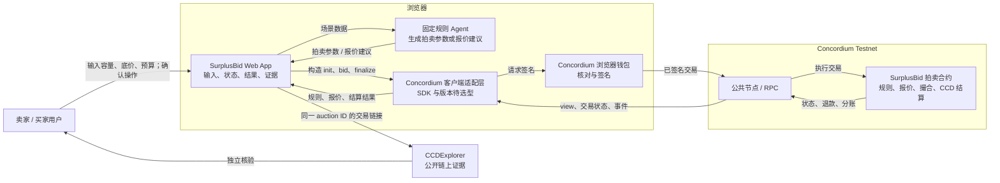
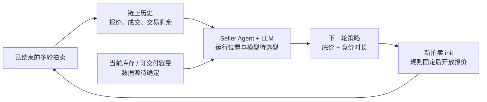

# SurplusBid MVP 架构

日期：2026-10-23

阶段：W2D1，从四幕 Demo 流程反推架构

## 架构边界

今天的 MVP 使用固定规则 Agent。卖家和买家的决策规则直接运行在浏览器 Web App 中，用户在
Concordium 浏览器钱包中核对并签名。当前主流程不设置后端进程、数据库、消息队列或自动定时任务。

前端框架、Concordium SDK 的仓库依赖与版本尚未选型；下图只固定组件职责与数据流，不把待选型技术写成既有实现。

当前固定演示使用底价 2 CCD 和固定 5 分钟竞价时长。每轮拍卖的底价、
竞价时长和费用规则一旦开始报价就不能修改。

## 从四幕流程得到的目标架构

图中“SurplusBid Web App”和“固定规则 Agent”是目标 MVP 组件，当前仓库尚未实现。现有仓库已经有
Rust 拍卖 spike 合约和验证脚本，但合约仍采用双方各固定 0.2 CCD 的旧费用规则。

## 未来 Seller Agent 的跨轮反馈循环

未来的 Seller Agent 不修改正在进行的拍卖。它只在一轮结束后分析历史和当前库存，为下一轮生成新的
底价与竞价时长。

预期机制是：如果供需关系相对稳定且历史交易剩余持续偏大，Seller Agent 可以提高下一轮底价；如果供给
增加、买家减少或成交率下降，则重新判断市场并调整底价和竞价时长。随着样本增加，底价可能逐渐接近当时
市场的支付意愿，交易剩余可能缩小。

这是一项需要真实多轮数据验证的产品假设。竞价策略、样本数量和供需变化都可能使结果不收敛，因此文档和
演示不能承诺交易剩余必然趋近于 0。

## 四幕对应的数据流

### 1. 输入：创建拍卖

1. 卖家在 Web App 输入服务容量与最低接受价格。
2. 固定规则 Seller Agent 生成服务标识、容量、底价、截止时间和最大报价数等参数。
3. Web App 展示完整参数，用户在钱包中核对并签名 `init`。
4. Testnet 节点执行拍卖合约初始化；Web App 从链上读回规则并展示创建交易证据。

固定规则 Seller Agent 以创建拍卖时的链上时间为基准，加 5 分钟生成截止时间。页面展示具体截止时间，
最终是否允许报价或结算仍由合约依据链上时间判断。

### 2. 动作：两个买家报价

1. Web App 从合约读取 `Open` 状态、底价和截止时间。
2. Buyer A、Buyer B 的固定规则分别生成 4 CCD、6 CCD 报价建议。
3. 用户分别在对应钱包账户中核对并签名 `bid`。
4. 合约记录报价金额和链上顺序，并托管两笔报价资金；Web App 读回状态。

报价代表买家的最高总支出上限。目标规则只锁入报价金额；当前 spike 合约仍要求额外锁入固定费用，二者不能混用。

### 3. 结果：触发结算

1. Web App 从链上时间和合约状态判断是否允许请求 `finalize`。
2. 截止前不提交结算；截止后由演示中的卖家发起钱包签名。协议允许任意账户触发。
3. 合约选择赢家、计算当前演示价格与平台费，并原子执行卖家收款、平台分账和买家退款。
4. Web App 读回最终状态，展示赢家、成交价、交易剩余、费用和资金守恒。

浏览器不替代合约判断截止时间，也不决定赢家或分账。即使页面逻辑被绕过，合约仍必须拒绝过早或重复结算。

### 4. 证据：独立核验

1. Web App 用同一个 auction ID 组织创建、A 报价、B 报价和结算交易。
2. Web App 从 Testnet 读取合约 `view`、交易最终状态和余额。
3. 每笔交易提供 CCDExplorer 链接，评委可以离开应用独立核验。
4. 页面展示重复 `finalize` 被拒绝的结果，证明不会再次付款或退款。

新费用规则和双买家 Testnet 交易尚未完成，因此目标 auction ID 与交易哈希仍为空，不能使用旧固定费用合约的哈希替代。

## 组件删除测试

| 组件 | 负责什么 | 删掉它会怎样 | 结论 |
| --- | --- | --- | --- |
| SurplusBid Web App | 收集输入，展示 Agent 建议、钱包状态、结算结果和证据 | 可以改用命令行，但三分钟 Demo 难以让评委看懂完整产品流程 | 留：Demo 必需；框架待选型 |
| 固定规则 Agent | 根据已确认的容量、底价和预算生成拍卖参数或报价建议 | 所有参数只能由用户手工填写，无法证明当前项目包含真实 Agent 决策 | 留：今天使用简单、可解释的规则 |
| Concordium 客户端适配层 | 编解码合约参数，读链，连接钱包并跟踪交易状态 | Web App 无法可靠提交交易或读取合约状态 | 留：具体 SDK 与版本待选型 |
| Concordium 浏览器钱包 | 选择账户，向用户展示交易并完成签名 | 浏览器不能以用户账户安全提交交易；若改用私钥托管会引入额外安全范围 | 留：用户授权边界 |
| Concordium Testnet 公共节点 / RPC | 广播交易并提供合约状态、交易状态和链上时间 | 无法完成真实 Testnet 端到端流程 | 留：外部依赖，需要超时与可读错误 |
| SurplusBid 拍卖合约 | 固定规则、接收报价、选择赢家、托管 CCD、分账和退款 | 赢家和付款只能由中心化代码决定，核心主张消失 | 留：协议核心 |
| CCDExplorer | 让评委独立查看交易与合约证据 | 协议仍能运行，但评委只能相信应用自身展示 | 留：演示证据组件，不参与协议执行 |
| 后端进程 | 当前无职责 | 删除后固定规则、钱包签名、读链和合约执行仍能完成 | 不留：今天不引入 |
| 数据库 | 当前无职责 | 拍卖规则与结算结果仍可从链上读取 | 不留：今天不引入 |
| 消息队列 | 当前无职责 | 单浏览器、有限交易无需异步分发系统 | 不留 |
| 定时任务 / Keeper | 自动调用 `finalize` | 删除后截止时间仍有效，由任意账户在截止后手动触发 | 不留：MVP 手动触发 |
| x402 | 可能用于赢家获得服务的交付接口 | 当前资金主线不受影响；其与 CCD 合约结算的关系尚未验证 | 暂不进入主架构：需要验证 |
| AI 服务 API | 可能生成最终的 Priority AI Analysis 内容 | 当前四幕只验证竞价和结算，没有确认模型供应商或交付流程 | 暂不进入主架构：后续 Agent 模块再定 |
| 历史数据聚合 | 为未来 Seller Agent 汇总多轮报价、成交与交易剩余 | 当前单轮固定规则仍可运行；未来动态策略缺少输入 | 今天不留；后续从链上历史开始验证 |
| 当前库存数据源 | 告诉未来 Seller Agent 当前可交付容量 | 当前容量固定为 1；未来无法判断供给变化 | 今天不留；数据源待确认 |
| LLM Seller Agent | 根据历史与库存提出下一轮底价和竞价时长 | 今天继续使用固定参数；未来无法形成动态策略 | 今天不留；学习 Agent 模块后再选型 |

## 已确认与待确认

### 已确认

- 固定规则 Agent 今天运行在浏览器 Web App 中。
- 用户通过 Concordium 浏览器钱包核对并签名。
- Concordium 拍卖合约执行赢家选择、定价、费用、分账和退款。
- 截止后由账户手动调用 `finalize`；不使用合约定时任务。
- 当前不需要后端、数据库或消息队列。
- x402 不参与当前 CCD 资金结算主线。
- 未来 Seller Agent 只为下一轮生成策略，不能修改已经开放报价的拍卖。

### 尚未确定，不能写成实现事实

- Web App 使用哪一种前端框架以及对应版本。
- Concordium 浏览器 SDK 的正式依赖和锁定版本。
- 固定规则 Agent 的输入数据结构、执行日志格式和错误状态。
- microCCD 百分比费用及双方平分的舍入规则。
- 网络失败时是否提交一份真实 Testnet 证据快照作为只读备用材料。
- x402、AI 服务和赢家服务交付的最终关系。
- 未来 Seller Agent 使用哪些历史窗口、供需指标和调整边界。
- 当前库存由哪个链下系统提供，以及如何证明数据没有过期。
- LLM Seller Agent 的运行位置、模型、调用成本、超时和失败回退策略。

## 当前实现差距

| 目标组件 | 仓库现状 |
| --- | --- |
| Web App | 尚无前端入口，`package.json` 也未定义 `dev` |
| 固定规则 Agent | 尚未实现 |
| Concordium 浏览器客户端 | 仅在临时验证页面中跑通过；尚未加入仓库依赖 |
| 新费用规则合约 | 尚未实现；当前 `auction-spike` 是固定 0.2 CCD / 方 |
| 双买家真实 Testnet 证据 | 尚未完成 |
| CCDExplorer 证据页 | 已有旧规则真实交易链接，目标新规则链接待生成 |
| x402 与服务交付 | 需要验证 |
