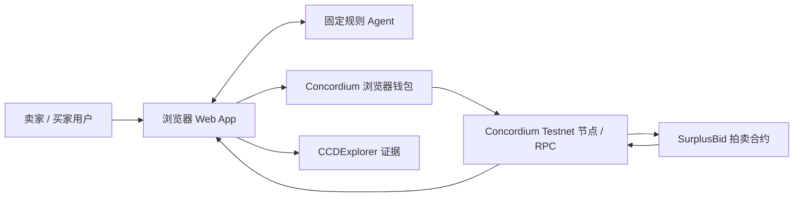

# Brief：Agent-to-Agent 动态竞价与交易撮合

## 定位

为需要购买稀缺数字服务的买家 Agent 和提供服务的卖家
Agent，在多买家竞争有限服务容量时改善交易撮合与结算效率；相较固定价格或由中心化中介自行决定结果的做法，关键差异是**由
Concordium 智能合约执行公开竞价、确定性撮合、成交定价与 CCD
结算**，并根据已确认的链上成交生成价格信号。本次通过一条可现场演示、可在区块浏览器核验的端到端交易证明其可行性。

## 目标赛事

-   **主赛 / 赛道：** Concordium Trusted Agents Hackathon（Encode
    Club）｜Agent commerce / Agent-to-Agent payments
-   **截止（北京时间）：** 2026-12-10 07:59（官方截止：2026-12-09 23:59
    UTC）；Checkpoint 1：2026-11-23 07:59（官方截止：2026-11-22 23:59
    UTC）。
-   **硬条件：** 项目运行在 Concordium
    Testnet；有意义地使用至少一个官方组件；提交公开代码仓库、最长 3
    分钟的演示视频、CCDExplorer
    链接，以及从测试网走向主网和真实用户的计划。
-   **必需集成：** Concordium Testnet
    上的竞价/撮合/结算流程；官方组件首选 **x402 Agent-to-Agent
    payments**。第一阶段必须验证 x402
    与合约结算链路能否合理衔接；若不兼容，应尽早改选 Agent Registry +
    Verified by Concordium badge
    作为官方组件，避免临近截止时才发现不满足赛事要求。
-   **赛事官方页面：**
    https://www.encodeclub.com/programmes/concordium-trusted-agents-hackathon

## 约束

-   **时间：** 单人开发；核心实现按 3 周控制。每天可投入小时数：待填写。
-   **我熟悉的：** Web2 后端与 API 思维；Java /
    Spring、SQL、数据处理和系统集成基础；Git/GitHub；已用 Remix 在 Base
    Sepolia 部署过简单 Solidity
    合约，并完成写入、读回和哈希篡改验证实验。
-   **我不熟悉、需要验证的：** Concordium 合约开发工具链与
    SDK；合约内竞价排序、CCD 资金锁定、分账和退款；x402
    与拍卖结算的集成方式；合约边界条件与安全测试。
-   **预算（模型 / 服务 / gas）：** 先使用 Concordium Testnet 与免费测试
    CCD；模型/API 预算待填写；不使用真实资金。私钥不得提交到仓库。

## 一条核心流程（用户视角，5 步以内）

1.  卖家 Agent
    创建一轮拍卖，声明服务标识、可交付容量、最低接受价格和截止条件。当前演示固定底价为 2 CCD，
    竞价时长为创建后的 5 分钟。
2.  多个买家 Agent 在截止前向合约提交公开报价，并按规则提供相应 CCD
    资金。
3.  Concordium
    合约过滤低于底价的报价，按报价排序并按容量选择赢家；同价时使用确定性规则处理平局。
4.  合约按固定规则计算成交价（MVP：`成交价 = (买家报价 + 卖家底价) / 2`），执行卖家收款、中介手续费分账，以及未中标者和赢家差额的退款。
5.  界面用同一个 auction ID 展示成交结果、资金流和 CCDExplorer
    链接，供参与方及评委独立核验。

目标 MVP 的组件、数据流、删除测试和当前实现差距见 [SurplusBid MVP 架构](architecture.md)。
当前已确认固定规则 Agent 运行在浏览器 Web App 中，由用户通过 Concordium 浏览器钱包核对并签名；
今天不引入后端、数据库、消息队列或自动结算任务。

## 链上做什么、为什么必须在链上

### 目标结算规则（2026-10-23）

- 赢家报价记为 `bid`，卖家底价记为 `reserve`，交易剩余价值
  `surplus = bid - reserve`。
- 当前演示暂用中点定价：`price = reserve + floor(surplus / 2)`。中点公式是待继续验证的
  MVP 机制，不是不可变的产品定义；任何拍卖采用的定价规则都必须在报价前公开并固定。
- 若 `surplus < price × 10%`，本次成交不收平台费；刚好等于该阈值时正常收费。
- 其余成交的平台费 `fee = surplus × 10%`，由买家和卖家平均承担；未成交不收费。
- 报价表示买家的最高总支出上限。买家只锁入 `bid`，合约必须保证
  `price + buyerFee <= bid`。赢家退回 `bid - price - buyerFee`，卖家收到
  `price - sellerFee`，平台收到 `fee`；未中标者退回全部报价。
- 所有金额使用整数 microCCD；百分比和双方平分产生的舍入规则仍需在实现前确定并测试。
- 费用规则、定价规则和平台收款地址在报价前固定；网络交易手续费由链另行收取，不属于平台费用。
- 例：底价 2 CCD，A 报价并存入 4 CCD，B 报价并存入 6 CCD，容量为 1。
  B 的交易剩余为 4 CCD，当前中点成交价为 4 CCD，平台费为 0.4 CCD；A 退回 4、
  B 退回 1.8、卖家收 3.8、平台收 0.4，合约余额归零。

当前已部署并验证的 spike 合约仍采用买卖双方各固定 0.2 CCD 的旧规则。上述目标规则尚未实现或完成
Testnet 验证，不得用旧合约的交易记录证明新规则已经跑通。

-   **链上动作：**
    拍卖创建、报价提交、容量分配、赢家选择、成交价计算、CCD
    资金处理与结算、退款和成交事件记录。
-   **为什么上链：**
    买家、卖家和中介存在不同利益。若撮合和结算都由中介后台决定，参与方必须信任中介没有擅自改变赢家、价格或手续费。将规则与资金处理放入
    Concordium
    合约后，参与方可以核对部署的规则、链上输入、执行结果和真实资金流向。
-   **去掉链上后：** Agent
    报价、撮合模拟和价格统计仍可由普通后端实现；但会失去可独立核验的链上撮合执行、原生
    CCD
    结算与退款，以及将成交结果和资金流向关联的核心差异。因此，链上不是可选的日志审计层，而是交易协议的执行层。
-   **评委验证方式：** 从界面创建拍卖开始，展示多个 Agent
    报价、合约撮合、成交价、收款与退款，再打开 CCDExplorer
    核对真实测试网交易。延后的价格统计面板只能使用已确认的链上成交生成。

## 本次做 / 延后 / 不承诺

-   **做：**
    单卖家、单轮、有限买家和小容量的公开竞价；固定底价与排序规则；当前演示暂用中点定价；预先固定并公开的手续费规则；CCD
    结算、未中标退款与赢家差额退款；交易状态、错误状态和区块浏览器链接。
-   **延后：** 密封竞价 /
    commit-reveal、买卖双方多轮自主议价、复杂托管与争议仲裁、多卖家多商品市场、成交价格统计、
    Seller Agent 根据历史成交、当前库存和历史交易剩余为下一轮动态生成底价与竞价时长、机器学习价格预测、生产级身份与声誉体系。
-   **不承诺：**
    报价隐私；保证价格等于"公允价值"；仅凭链上记录证明服务质量；未经安全审计即可承载真实资产；声称智能合约执行正确就代表经济规则必然公平。

未来动态 Seller Agent 只能为尚未开始报价的新一轮拍卖生成策略。供需稳定时底价可能逐渐接近市场支付意愿、
交易剩余可能缩小，但这是需要多轮真实数据验证的机制假设，不承诺交易剩余必然趋近于 0。

## 最大的未知项（按风险排序）

1.  **Concordium 合约能否在可接受的开发时间内完成报价接收、排序、CCD
    资金处理、分账和退款。**
    先做最小技术验证：部署最小合约并跑通一笔报价、一个中标结果和一笔退款；任何资金路径未验证前，不扩展功能。
2.  **赛事组件集成是否与链上拍卖结算兼容。** 优先验证 x402
    支付如何与拍卖合约衔接；若无法形成清晰、真实的端到端流程，尽早改用
    Agent Registry + Verified by Concordium
    badge，并确保至少一个官方组件被有意义地使用。

## 验收条件

-   **成功：** Concordium Testnet
    上部署并运行最小拍卖；多个买家提交报价后，合约按固定规则选出赢家并计算成交价；结算正确支付卖家和手续费、退回未中标者资金及赢家差额；重复结算被拒绝；评委能从
    CCDExplorer 核验交易；公开仓库、3
    分钟以内演示视频和主网落地计划齐备。
-   **失败时应有的行为：**
    无报价满足底价时不成交并按规则退款；超时、交易失败或重复调用时明确显示状态，不重复付款、不重复退款、不丢失资金状态；官方组件集成未验证前不宣称完成；若合约资金处理无法在第一阶段打通，立即缩小范围并重新评估方案，不以模拟交易冒充真实链上结算。
